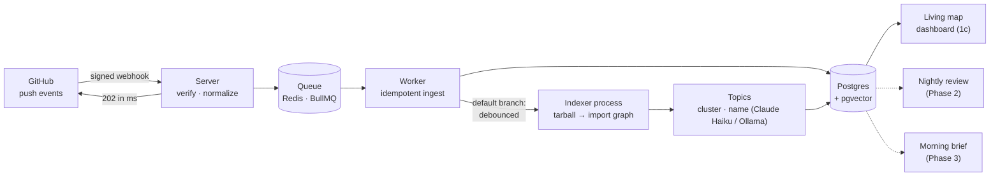
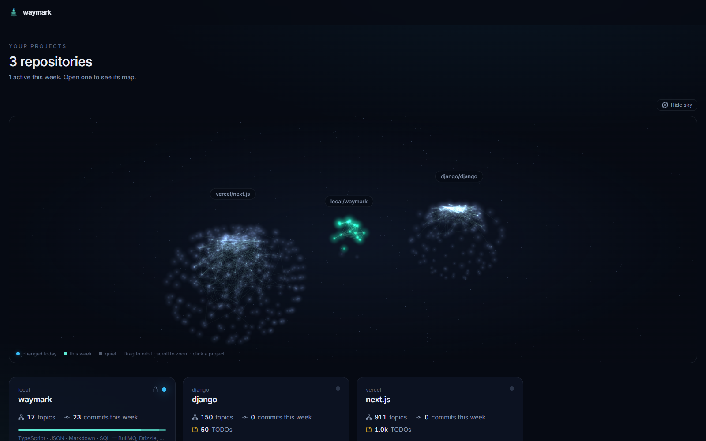
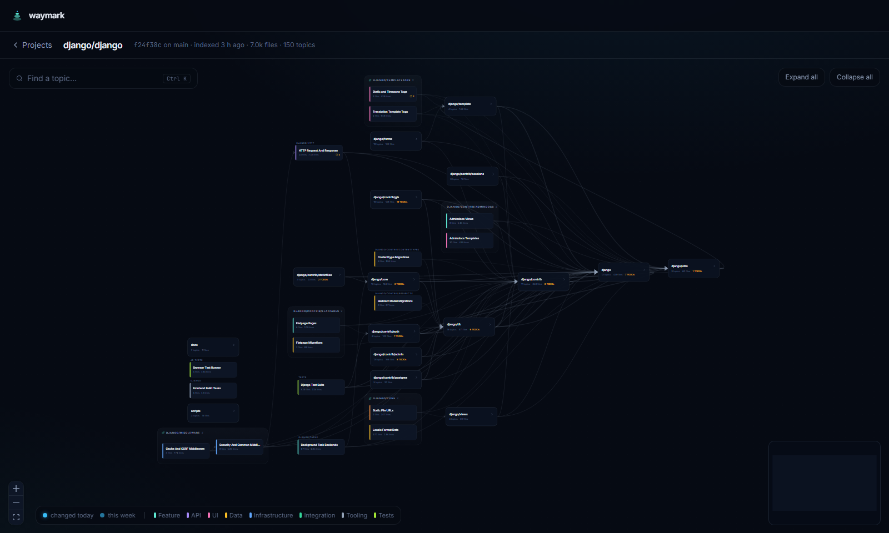
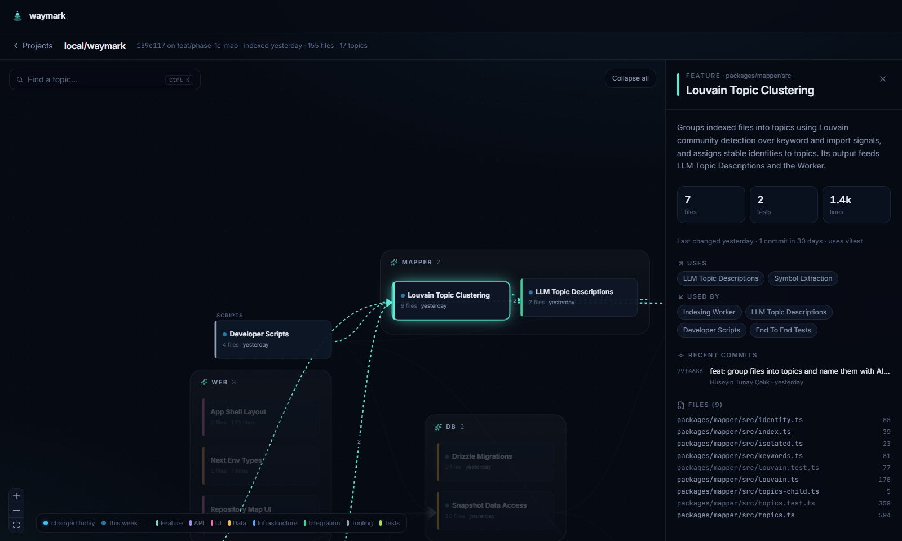

<div align="center">

# Waymark

**A personal agent that maps your projects, reviews your work, and tells you where you left off.**

[](https://github.com/Tunaycel/waymark/actions/workflows/ci.yml)
[](LICENSE)


</div>

---

Most developer tools look at one pull request at a time. Waymark looks at **you**: every repository
you work in, every day. It keeps a living map of each project, reviews what you changed before
the day ends, and when you come back after a week away, it answers the first question you have:
*where was I?*

It is built to grow beyond code: calendar, tasks, mail, and anything else you ask it to watch, so
your morning brief covers your whole day, not just your repositories.

> [!NOTE]
> Waymark is in **Phase 1c**: every repository is ingested, indexed, grouped into named topics
> ("Session Auth", "Stripe Webhooks"), and shown as an interactive map in a local dashboard.
> Next: a 3D overview, then GitHub sign-in with hosting, then chatting with Waymark on Telegram.
> See the [roadmap](docs/ROADMAP.md).

## How it works



GitHub gives a webhook receiver **10 seconds** before it marks the delivery failed. So the server
does only the cheap, safety-critical work (signature check, validation, enqueue) and answers
immediately; everything slow happens in workers that retry on failure. The full design, with the
reasoning behind each decision, is in [docs/ARCHITECTURE.md](docs/ARCHITECTURE.md).

## The map

<!-- screenshots -->
<p align="center">
  
</p>

| | |
|---|---|
|  |  |

The welcome screen shows every project as a constellation: one star per topic, glowing where you
worked today or this week, with signals running along the imports from where work happened. Drag
to orbit, click a project to open its map.

Each project is a map: topics are nodes, imports are edges, and topics changed in the last day or
week glow. Large repositories open as a handful of regions (packages, or directories inside one)
and expand on click; search (Ctrl K) jumps to any topic and opens what is around it. The side
panel shows a topic's summary, what it uses and what uses it, its TODOs, recent commits, and files.

```bash
pnpm demo .                     # map this checkout (or any local path / owner/repo)
pnpm web                        # http://127.0.0.1:3100
```

## Engineering guarantees

Each guarantee below is enforced in code **and** pinned by a test.

| Guarantee | How | Test |
|---|---|---|
| Only GitHub can enqueue work | HMAC-SHA256 over the raw body, constant-time compare, checked before anything else is parsed | [`signature.test.ts`](packages/core/src/github/signature.test.ts) · GitHub's published test vector |
| Redelivered webhooks are processed once | Queue job id = `X-GitHub-Delivery` | [`pipeline.test.ts`](tests/e2e/src/pipeline.test.ts) |
| "Redeliver" still works after a job failed for good | A redelivery of a permanently failed job re-queues it instead of being swallowed as a duplicate | `pipeline.test.ts` · simulated outage → recovery |
| A Redis outage never hangs GitHub's request | Fail-fast producer connection + 5 s enqueue timeout → `503`, which GitHub shows as redeliverable | `pipeline.test.ts` · closed-port Redis |
| Retries never duplicate data | `UNIQUE(repository_id, sha)` + `ON CONFLICT DO NOTHING` in one transaction | [`ingest.test.ts`](tests/e2e/src/ingest.test.ts) · 5 concurrent deliveries → exactly one copy |
| Out-of-order events can't move state backwards | Freshness is the server's receive time, not commit timestamps (author clocks lie); stale events can't rewind `last_push_at` or undo a rename | `ingest.test.ts` |
| The largest possible push is handled | 25 MB body limit (GitHub's cap); inserts chunked below Postgres' 65,535-parameter limit | `ingest.test.ts` · 2,048-commit push |
| Personal data is minimized | Author emails are dropped during parsing and never reach the queue or the database | [`push.test.ts`](packages/core/src/github/push.test.ts) |
| A burst of pushes is indexed once; a push during indexing is never lost | Per-repository BullMQ deduplication: replace while delayed, keep the newest while running | [`indexing.test.ts`](tests/e2e/src/indexing.test.ts) · real Redis |
| Import edges are exact, not grep-based | Own tokenizers skip comments, strings, templates, and regexes; resolvers follow Node/TS, `tsconfig` paths, workspace `exports`, Python package roots, `go.mod` | [`lexers.test.ts`](packages/indexer/src/lexers/lexers.test.ts) · [`resolve.test.ts`](packages/indexer/src/resolve/resolve.test.ts) · 100 % resolved on this repo |
| A hostile repository can't stall or crash the worker | Indexing runs in a child process with hard time and heap budgets; every lexer, resolver, and parser is linear on adversarial input; archives are metered after decompression | [`isolated.test.ts`](packages/indexer/src/isolated.test.ts) · [`regressions.test.ts`](packages/indexer/src/regressions.test.ts) |
| AI spend never exceeds the monthly cap | One Postgres lock for all spending across workers; every billed call recorded (also refused or malformed ones); unknown costs charged at the worst case; unchanged topics reuse their paid description | [`describe.test.ts`](packages/mapper/src/describe/describe.test.ts) · [`topics.test.ts`](tests/e2e/src/topics.test.ts) |
| Topics are deterministic and stable | Deterministic Louvain within package boundaries; ids carried over by file overlap, so small changes keep the same map node | [`topics.test.ts`](packages/mapper/src/topics.test.ts) |
| Repository content is data, never code | Nothing is executed; symlinks and paths outside the archive root are skipped; text Postgres rejects (NUL, broken surrogates) is cleaned | [`sources.test.ts`](packages/indexer/src/sources/sources.test.ts) · `indexing.test.ts` |
| Other websites can't read the local dashboard | Loopback-only bind plus a `Host` check against DNS rebinding; the web process gets `DATABASE_URL` and no API keys; a topic panel only answers for a snapshot of the repository asked for | [`paths.test.ts`](apps/web/src/lib/paths.test.ts) · [`dashboard.test.ts`](tests/e2e/src/dashboard.test.ts) |
| Tests never touch your data | Integration tests run in their own `<db>_test` database and refuse any database not named `*_test` | [`helpers.ts`](tests/e2e/src/helpers.ts) |
| Misconfiguration fails at startup, all at once | zod-validated environment, every problem reported together | [`env.test.ts`](packages/core/src/env.test.ts) |

## Metrics

<!-- metrics:start -->
Measured with [`pnpm bench`](scripts/bench-webhook.ts) against a live server + worker, Postgres 17
and Redis 7 in Docker, on a laptop (Intel i7-13700H, Windows 11). Numbers are for this setup, not a
capacity promise.

| Scenario | Result |
|---|---|
| Webhook acknowledgement, sequential (300 deliveries) | **p50 4.2 ms · p95 5.8 ms · p99 7.4 ms** |
| Webhook acknowledgement, 50 concurrent (1,000 deliveries) | p50 67.5 ms · p99 251 ms · max 258 ms · 619 req/s |
| End-to-end persistence under that load | **5,000 / 5,000 commits stored**, ~690 commits/s, 0 errors |
| Redis goes down mid-operation | `503` in **0.22 s** (`/readyz` → 503); worker reconnects by itself, redelivery succeeds |
| Redis unreachable from startup | `503` after the 5 s enqueue timeout, inside GitHub's 10 s window |
| Largest GitHub push (2,048 commits) | ingested in one transaction in ~0.5 s |

**Repository indexing**, measured with [`pnpm bench:index`](scripts/bench-index.ts) on public
GitHub tarballs (same streaming path as the worker; download time excluded):

| Repository | Files | Lines | File edges | Modules | Internal imports resolved | Index | Store in Postgres |
|---|---:|---:|---:|---:|---:|---:|---:|
| fastify/fastify (JS) | 392 | 102 k | 593 | 11 | **100 %** | 0.14 s | 0.21 s |
| gin-gonic/gin (Go) | 130 | 29 k | 31 | 11 | **100 %** | 0.05 s | 0.06 s |
| fastapi/fastapi (Python) | 3,243 | 394 k | 1,797 | 7 | **100 %** | 0.46 s | 0.55 s |
| prometheus/prometheus (Go + TS) | 1,767 | 496 k | 2,606 | 33 | **100 %** | 0.60 s | 0.28 s |
| django/django (Python) | 7,028 | 553 k | 9,073 | 9 | **100 %** | 0.97 s | 0.67 s |
| vercel/next.js (TS monorepo) | 33,698 | 2.48 M | 25,603 | 747 | 98.2 % ¹ | 3.8 s | 3.0 s |

¹ The remainder are imports of files generated at build time (e.g. benchmark templates).

**Topics**, built from those indexes; names and summaries by Claude Haiku 5.5 (first build; later
builds only re-describe topics that changed):

| Repository | Topics | Clustering | Naming | AI cost |
|---|---:|---:|---:|---:|
| this repository | 14 | 9 ms | 6 s | **$0.0016** |
| fastify/fastify | 8 | 9 ms | 8 s | $0.0011 |
| django/django | 149 | 67 ms | 25 s | **$0.019** |
| vercel/next.js | 875 | 4.0 s | ~3 min | ~$0.12 |

Example names from this repository: *Fastify Server*, *Import Path Resolution*, *Isolated
Indexing*, *GitHub App Client*, *Louvain Topic Clustering*.
Throughput is 2.5k–8.9k files/s on one core; next.js peaks at +228 MB RSS.

**Dashboard**, first view of each map (data load from Postgres, then grouping and ELK layout in the
browser):

| Repository | Topics | Import edges | First view | Data load | Layout |
|---|---:|---:|---:|---:|---:|
| this repository | 17 | 35 | 21 nodes | 17 ms | 69 ms |
| django/django | 150 | 1,560 | 38 nodes | 12 ms | 109 ms |
| vercel/next.js | 911 | 2,613 | 16 nodes | 85 ms | 30 ms |

| Quality gate | Value |
|---|---|
| Unit tests | 301 (no infrastructure required), incl. timed adversarial-input regressions |
| Integration tests | 40 (real Postgres + Redis, in a separate `<db>_test` database; incl. failure recovery, index scheduling, topic building, budget across workers, dashboard read models) |
| Type safety | `strict` + `noUncheckedIndexedAccess` + `exactOptionalPropertyTypes` |
| Build step | none: Node runs the TypeScript sources directly |
<!-- metrics:end -->

## Quick start

**Requirements:** Node ≥ 22.18, pnpm 10, Docker.

```bash
git clone https://github.com/Tunaycel/waymark.git && cd waymark
pnpm install
cp .env.example .env          # then set GITHUB_WEBHOOK_SECRET
pnpm infra:up                 # Postgres :5433, Redis :6380
pnpm db:migrate
pnpm dev                      # server on :3000 + worker
```

Then connect a GitHub App by following [docs/GITHUB_APP.md](docs/GITHUB_APP.md). Indexing
needs the App's ID and private key in `.env`; without them, pushes are still ingested. For AI topic
names, add `ANTHROPIC_API_KEY` (or `OLLAMA_MODEL` for a free local model); without either, topics
get heuristic names.

| Command | What it does |
|---|---|
| `pnpm test` | Unit tests |
| `pnpm test:integration` | End-to-end against real Postgres + Redis (`pnpm infra:up` first) |
| `pnpm lint` / `pnpm lint:fix` | Biome lint and format |
| `pnpm check:text` | Reject invisible and control characters in tracked files (also in CI) |
| `pnpm typecheck` | Strict TypeScript across all packages |
| `pnpm db:generate` | Generate a migration after editing the schema |
| `pnpm bench [n] [concurrency] [commits]` | Load-test a running server + worker |
| `pnpm map:local <path>` | Index a local checkout and print modules, edges, dependencies |
| `pnpm topics:local <path or owner/repo> [--describe]` | Print topics; `--describe` names them with Claude (uses `ANTHROPIC_API_KEY`, capped at $0.50 per run) |
| `pnpm bench:index owner/repo …` | Index public GitHub repositories and report timings |
| `pnpm demo <path or owner/repo> [--describe]` | Index a repository into the local database for the dashboard, without the GitHub App |
| `pnpm web` | Dashboard on http://127.0.0.1:3100 (local only, no authentication) |

## Repository layout

```text
apps/
  web/        Next.js dashboard: project list, interactive map (React Flow + ELK), topic panel
  server/     Fastify webhook receiver: verify → normalize → enqueue
  worker/     BullMQ consumer: persists events
packages/
  core/       Env validation, GitHub signature + payload parsing (pure, no I/O)
  db/         Drizzle schema, migrations, idempotent ingestion, snapshots
  github/     GitHub App client: JWT, installation tokens, repository reads, tarballs
  indexer/    Tokenizers, import resolvers, module graph, symbols, sources, isolated process
  mapper/     Topic clustering (Louvain), stable ids, AI naming (Claude / Ollama) with budget
  queue/      Queue/worker factories, job types, health check
tests/
  e2e/        Integration tests against real Postgres + Redis
scripts/      Webhook load test, indexer benchmark, demo seeding
docs/         Architecture, roadmap, GitHub App setup
```

## Roadmap

| Phase | Ships | Status |
|---|---|---|
| 0 · Foundation | Reliable GitHub ingestion | ✅ |
| 1a · Indexer | Import graph, modules, dependencies, TODOs per repository | ✅ |
| 1b · Topics | Files grouped into named, summarised topics | ✅ |
| 1c · Living map | Local dashboard with an interactive map of every project; then a 3D overview | 🚧 |
| 1c-3 · Hosting | Sign in with GitHub, your repositories indexed automatically, runs 24/7 | 📋 |
| 1d · Ask Waymark | Chat with an agent about your projects on Telegram | 📋 |
| 1e · Where you left off | Recently touched topics, open branches, new TODOs | 📋 |
| 2 · Review | Per-push triage, nightly review, pattern memory | 📋 |
| 3 · Life layer | Calendar, tasks, morning brief; WhatsApp as a second channel | 📋 |
| 4 · Ecosystem | MCP server, works inside other agents | 📋 |
| 5 · Watches | Payments, regulations, events: anything you add | 📋 |

## License

[AGPL-3.0](LICENSE). You can use, modify, and self-host Waymark freely. If you offer a modified
version as a network service, you must publish your changes under the same license.
