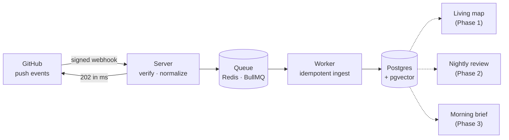

<div align="center">

# Waymark

**A personal agent that maps your projects, reviews your work, and tells you where you left off.**

[](https://github.com/Tunaycel/waymark/actions/workflows/ci.yml)
[](LICENSE)


</div>

---

Most developer tools look at one pull request at a time. Waymark looks at **you**: every repository
you work in, every day. It keeps a living map of each project, reviews what you changed before
the day ends, and when you come back after a week away, it answers the first question you have:
*where was I?*

It is built to grow beyond code: calendar, tasks, mail, and anything else you ask it to watch, so
your morning brief covers your whole day, not just your repositories.

> [!NOTE]
> Waymark is in **Phase 0**: the ingestion foundation. The map, reviews, and briefs are next.
> See the [roadmap](docs/ROADMAP.md).

## How it works



GitHub gives a webhook receiver **10 seconds** before it marks the delivery failed. So the server
does only the cheap, safety-critical work (signature check, validation, enqueue) and answers
immediately; everything slow happens in workers that retry on failure. The full design, with the
reasoning behind each decision, is in [docs/ARCHITECTURE.md](docs/ARCHITECTURE.md).

## Engineering guarantees

Each guarantee below is enforced in code **and** pinned by a test.

| Guarantee | How | Test |
|---|---|---|
| Only GitHub can enqueue work | HMAC-SHA256 over the raw body, constant-time compare, checked before anything else is parsed | [`signature.test.ts`](packages/core/src/github/signature.test.ts) · GitHub's published test vector |
| Redelivered webhooks are processed once | Queue job id = `X-GitHub-Delivery` | [`pipeline.test.ts`](tests/e2e/src/pipeline.test.ts) |
| "Redeliver" still works after a job failed for good | A redelivery of a permanently failed job re-queues it instead of being swallowed as a duplicate | `pipeline.test.ts` · simulated outage → recovery |
| A Redis outage never hangs GitHub's request | Fail-fast producer connection + 5 s enqueue timeout → `503`, which GitHub shows as redeliverable | `pipeline.test.ts` · closed-port Redis |
| Retries never duplicate data | `UNIQUE(repository_id, sha)` + `ON CONFLICT DO NOTHING` in one transaction | [`ingest.test.ts`](tests/e2e/src/ingest.test.ts) · 5 concurrent deliveries → exactly one copy |
| Out-of-order events can't move state backwards | Freshness is the server's receive time, not commit timestamps (author clocks lie); stale events can't rewind `last_push_at` or undo a rename | `ingest.test.ts` |
| The largest possible push is handled | 25 MB body limit (GitHub's cap); inserts chunked below Postgres' 65,535-parameter limit | `ingest.test.ts` · 2,048-commit push |
| Personal data is minimized | Author emails are dropped during parsing and never reach the queue or the database | [`push.test.ts`](packages/core/src/github/push.test.ts) |
| Misconfiguration fails at startup, all at once | zod-validated environment, every problem reported together | [`env.test.ts`](packages/core/src/env.test.ts) |

## Metrics

<!-- metrics:start -->
Measured with [`pnpm bench`](scripts/bench-webhook.ts) against a live server + worker, Postgres 17
and Redis 7 in Docker, on a laptop (Intel i7-13700H, Windows 11). Numbers are for this setup, not a
capacity promise.

| Scenario | Result |
|---|---|
| Webhook acknowledgement, sequential (300 deliveries) | **p50 4.2 ms · p95 5.8 ms · p99 7.4 ms** |
| Webhook acknowledgement, 50 concurrent (1,000 deliveries) | p50 67.5 ms · p99 251 ms · max 258 ms · 619 req/s |
| End-to-end persistence under that load | **5,000 / 5,000 commits stored**, ~690 commits/s, 0 errors |
| Redis goes down mid-operation | `503` in **0.22 s** (`/readyz` → 503); worker reconnects by itself, redelivery succeeds |
| Redis unreachable from startup | `503` after the 5 s enqueue timeout, inside GitHub's 10 s window |
| Largest GitHub push (2,048 commits) | ingested in one transaction in ~0.5 s |

| Quality gate | Value |
|---|---|
| Unit tests | 56 (no infrastructure required) |
| Integration tests | 15 (real Postgres + Redis, incl. failure recovery) |
| Type safety | `strict` + `noUncheckedIndexedAccess` + `exactOptionalPropertyTypes` |
| Build step | none: Node runs the TypeScript sources directly |
<!-- metrics:end -->

## Quick start

**Requirements:** Node ≥ 22.18, pnpm 10, Docker.

```bash
git clone https://github.com/Tunaycel/waymark.git && cd waymark
pnpm install
cp .env.example .env          # then set GITHUB_WEBHOOK_SECRET
pnpm infra:up                 # Postgres :5433, Redis :6380
pnpm db:migrate
pnpm dev                      # server on :3000 + worker
```

Then connect a GitHub App by following [docs/GITHUB_APP.md](docs/GITHUB_APP.md).

| Command | What it does |
|---|---|
| `pnpm test` | Unit tests |
| `pnpm test:integration` | End-to-end against real Postgres + Redis (`pnpm infra:up` first) |
| `pnpm lint` / `pnpm lint:fix` | Biome lint and format |
| `pnpm typecheck` | Strict TypeScript across all packages |
| `pnpm db:generate` | Generate a migration after editing the schema |
| `pnpm bench [n] [concurrency] [commits]` | Load-test a running server + worker |

## Repository layout

```text
apps/
  server/     Fastify webhook receiver: verify → normalize → enqueue
  worker/     BullMQ consumer: persists events
packages/
  core/       Env validation, GitHub signature + payload parsing (pure, no I/O)
  db/         Drizzle schema, migrations, idempotent ingestion
  queue/      Queue/worker factories, job types, health check
tests/
  e2e/        Integration tests against real Postgres + Redis
scripts/      Load test (pnpm bench)
docs/         Architecture, roadmap, GitHub App setup
```

## Roadmap

| Phase | Ships | Status |
|---|---|---|
| 0 · Foundation | Reliable GitHub ingestion | 🚧 |
| 1 · Living map | Interactive project map + "where you left off" | 📋 |
| 2 · Review | Per-push triage, nightly review, pattern memory | 📋 |
| 3 · Life layer | Calendar, tasks, morning brief on WhatsApp/Telegram | 📋 |
| 4 · Ecosystem | MCP server, works inside other agents | 📋 |
| 5 · Watches | Payments, regulations, events: anything you add | 📋 |

## License

[AGPL-3.0](LICENSE). You can use, modify, and self-host Waymark freely. If you offer a modified
version as a network service, you must publish your changes under the same license.
