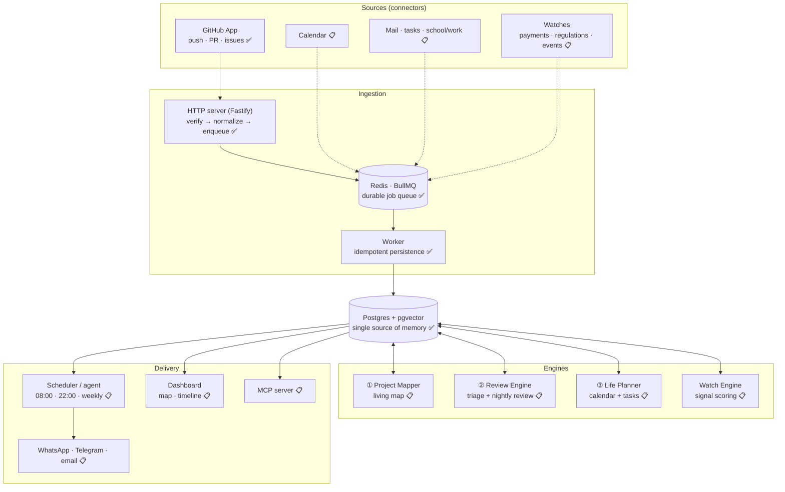
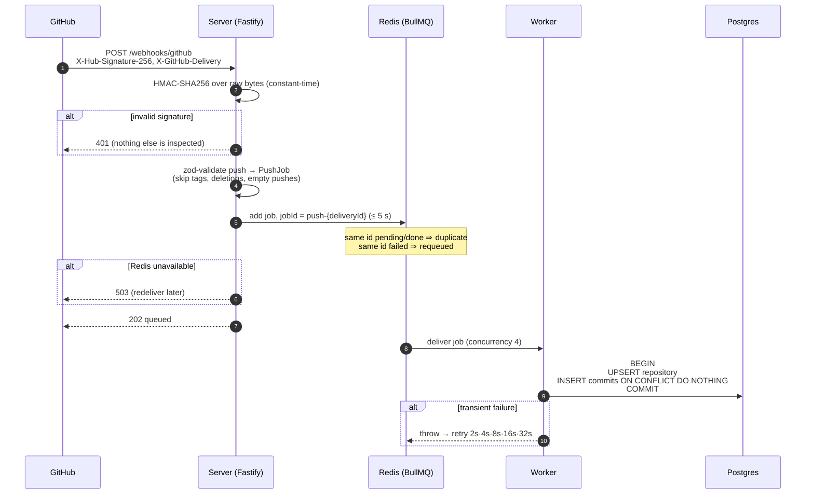
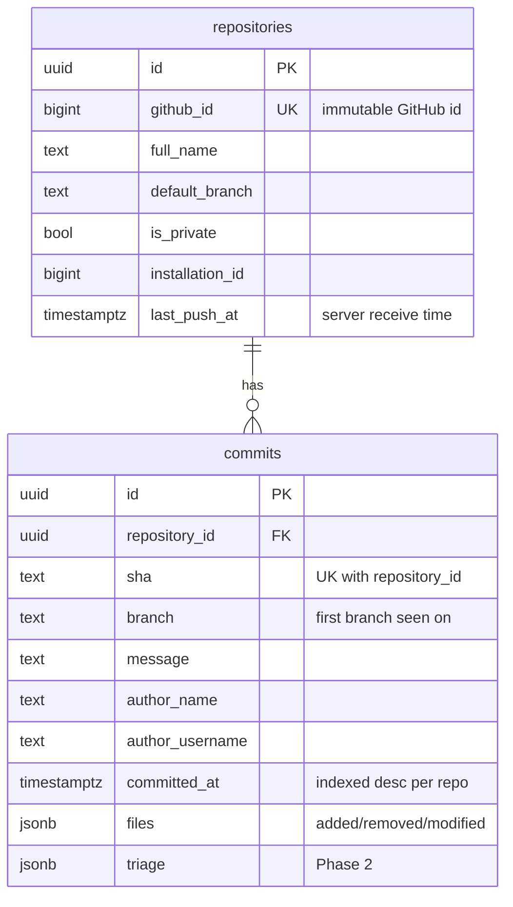

# Waymark architecture

> Status legend: ✅ built · 🚧 in progress · 📋 planned. Phase numbers refer to [ROADMAP.md](ROADMAP.md).

## 1. What the system does

Waymark watches the sources of a person's work and life, turns every event into a **signal**, scores
it, and keeps two artefacts up to date:

- a **living map** of every project: modules, features, progress, and *where you left off*;
- **briefs**: a nightly review of the day's work, a morning plan, a weekly report.

The user never triggers anything. Sources push events in; scheduled agents read the accumulated
memory and write the briefs.

## 2. System overview

### Why this shape

| Decision | Reason |
|---|---|
| **Queue between HTTP and processing** | GitHub waits at most **10 s** for a webhook response and marks slower deliveries failed. The server only verifies, normalizes, and enqueues (milliseconds); slow work (DB, LLM calls later) happens in workers with retries. |
| **One database for everything** | The engines are valuable *because* they see each other's data (a review knows the map; the planner knows the review). Postgres + pgvector keeps relational data and embeddings in one transactional store. |
| **Normalize at the edge** | Raw payloads are validated with zod and reduced to small internal types (`PushJob`). Engines never depend on GitHub's payload shape, and unneeded personal data (author emails) is dropped before it is stored. |
| **TypeScript everywhere, no build step** | One language across server, workers, and dashboard lowers the bar for contributors. Node ≥ 22.18 strips types natively, so packages ship `.ts` sources directly. |

## 3. Phase 0: ingestion pipeline ✅

### Correctness guarantees

| Property | Mechanism | Verified by |
|---|---|---|
| Only GitHub can enqueue work | HMAC-SHA256 over the exact raw body, `timingSafeEqual`, checked before any other parsing | `signature.test.ts`, `app.test.ts` (incl. GitHub's published test vector) |
| Redelivery doesn't double-process | BullMQ job id derived from `X-GitHub-Delivery` | `pipeline.test.ts` |
| Retries and replays don't duplicate data | `UNIQUE (repository_id, sha)` + `ON CONFLICT DO NOTHING`, one transaction per push | `ingest.test.ts` (replay, 5× concurrent delivery) |
| A commit pushed to several branches is stored once | same unique key; first branch wins | `ingest.test.ts` |
| Renames/visibility changes are followed | repository keyed by immutable GitHub id, mutable fields updated on every push | `ingest.test.ts` |
| Out-of-order deliveries don't regress state | `last_push_at` is the server receive time (commit timestamps come from author machines and can be wrong); metadata is only overwritten by newer events | `ingest.test.ts` |
| Redis outage never hangs a webhook | producer connection has no offline queue; enqueue has a 5 s timeout → `503` | `pipeline.test.ts`, chaos run (README) |
| Redelivery recovers permanently failed jobs | a redelivered job id in `failed` state is retried, not treated as duplicate | `pipeline.test.ts` |
| Webhooks that can't be authentic aren't buffered | malformed/missing signature header rejected in `onRequest`, before the body is read | `app.test.ts` |
| Largest possible push is accepted | 25 MB body limit (GitHub's cap); inserts chunked under Postgres' 65,535-parameter limit | `ingest.test.ts` (2,048 commits) |
| Server doesn't fail health checks on a Redis outage silently | `/readyz` uses a fail-fast Redis connection (offline queue disabled) | `app.test.ts` |

### Data model (Phase 0)

## 4. Engines (planned)

### ① Project Mapper: the living map (Phase 1)
- **Initial index:** file tree, README, manifests, and a tree-sitter import graph. An LLM groups
  files into meaningful topics ("Auth", "Payments", "Editor UI") → a graph of nodes and edges.
- **Incremental update:** each push maps its changed files to affected nodes; only those nodes are
  re-summarized. The repository is never re-read wholesale.
- **"Where you left off":** recently touched nodes, open branches, unfinished PRs, new
  TODO/FIXME, WIP commits, and the next roadmap milestone.

### ② Review Engine (Phase 2)
- **Triage on every push** (small, fast model): risk level, category, "untested change". Stored,
  not notified.
- **Nightly deep review** (batch API): the day's diffs + map context + the user's pattern memory →
  risky changes, recurring mistakes, three suggestions for tomorrow.
- **Pattern memory:** findings are keyed and counted ("missing null check ×4"), feeding the weekly
  progress report.

### ③ Life Planner and Watch Engine (Phases 3–5)
- Calendar events, school/work tasks, and project milestones are normalized into one task model.
- A **watch** is a natural-language instruction turned into a scheduled check ("rent is due on the
  5th", "regulations affecting my company", "jazz events near me"). Each produces signals that are
  scored for importance; only the top items reach the morning brief.
- Hard limits: watches **observe and remind**. They never move money, and regulatory alerts always
  link to the official source and are not legal advice.

## 5. Security and privacy model

- GitHub App with minimum permissions: `metadata:read`, `contents:read` (plus `pull_requests:write`
  only if the user enables fix-PR suggestions).
- Webhook secret ≥ 16 chars, enforced at startup.
- Store summaries, not source code. Drop data the product doesn't use.
- Self-hostable end to end; local-model support is planned for users who keep everything on their
  own machine.
- The agent asks before it sends anything on the user's behalf.
