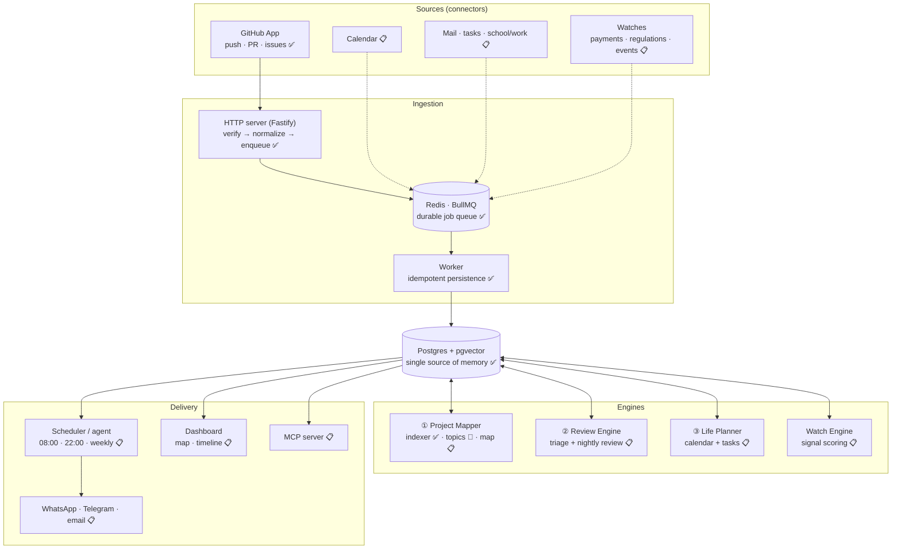
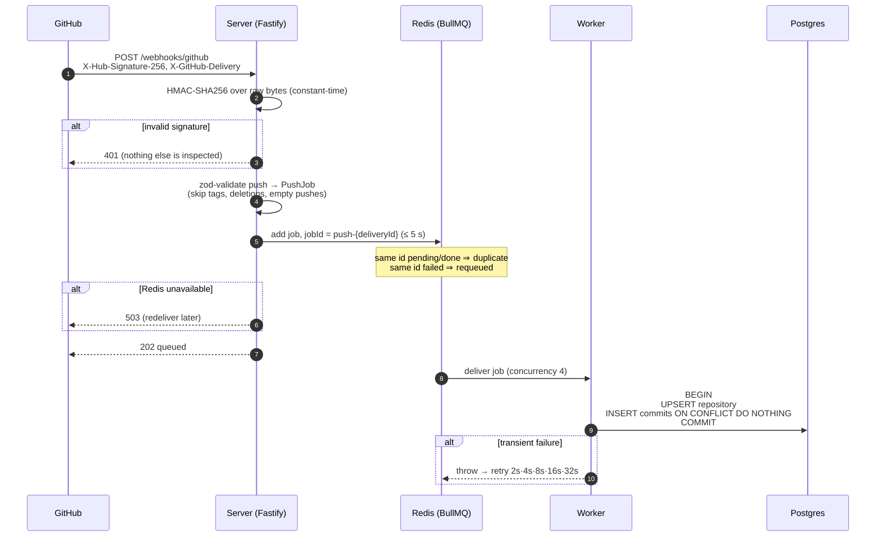
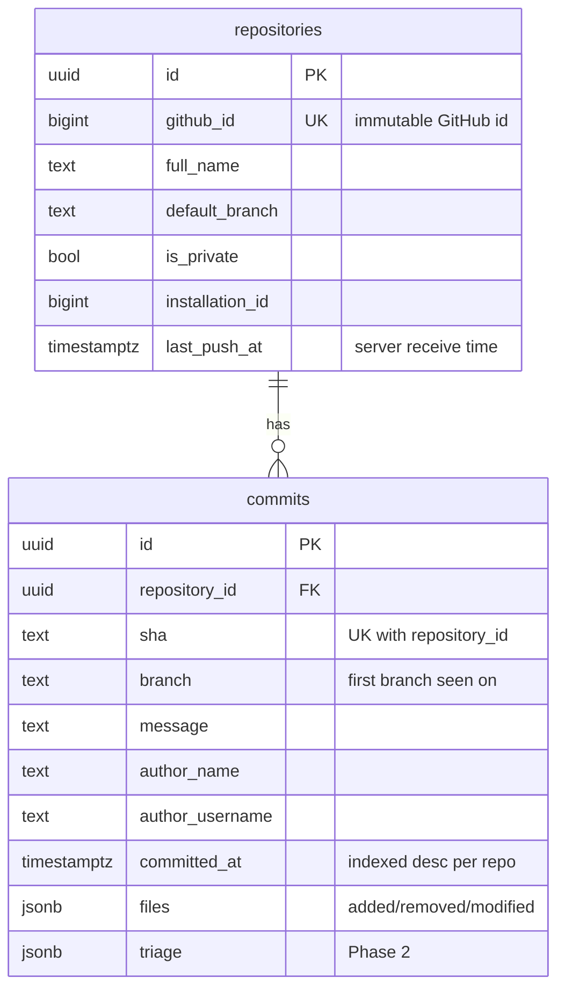
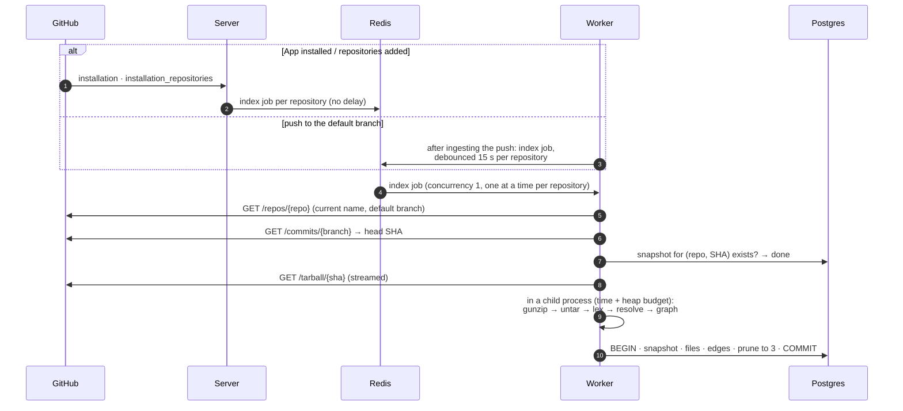
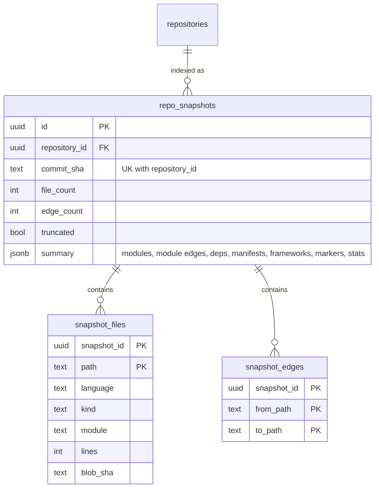
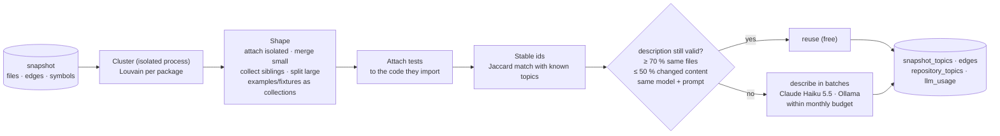
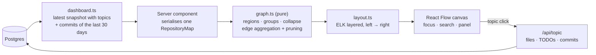

# Waymark architecture

> Status legend: ✅ built · 🚧 in progress · 📋 planned. Phase numbers refer to [ROADMAP.md](ROADMAP.md).

## 1. What the system does

Waymark watches the sources of a person's work and life, turns every event into a **signal**, scores
it, and keeps two artefacts up to date:

- a **living map** of every project: modules, features, progress, and *where you left off*;
- **briefs**: a nightly review of the day's work, a morning plan, a weekly report.

The user never triggers anything. Sources push events in; scheduled agents read the accumulated
memory and write the briefs.

## 2. System overview

### Why this shape

| Decision | Reason |
|---|---|
| **Queue between HTTP and processing** | GitHub waits at most **10 s** for a webhook response and marks slower deliveries failed. The server only verifies, normalizes, and enqueues (milliseconds); slow work (DB, LLM calls later) happens in workers with retries. |
| **One database for everything** | The engines are valuable *because* they see each other's data (a review knows the map; the planner knows the review). Postgres + pgvector keeps relational data and embeddings in one transactional store. |
| **Normalize at the edge** | Raw payloads are validated with zod and reduced to small internal types (`PushJob`). Engines never depend on GitHub's payload shape, and unneeded personal data (author emails) is dropped before it is stored. |
| **TypeScript everywhere, no build step** | One language across server, workers, and dashboard lowers the bar for contributors. Node ≥ 22.18 strips types natively, so packages ship `.ts` sources directly. |

## 3. Phase 0: ingestion pipeline ✅

### Correctness guarantees

| Property | Mechanism | Verified by |
|---|---|---|
| Only GitHub can enqueue work | HMAC-SHA256 over the exact raw body, `timingSafeEqual`, checked before any other parsing | `signature.test.ts`, `app.test.ts` (incl. GitHub's published test vector) |
| Redelivery doesn't double-process | BullMQ job id derived from `X-GitHub-Delivery` | `pipeline.test.ts` |
| Retries and replays don't duplicate data | `UNIQUE (repository_id, sha)` + `ON CONFLICT DO NOTHING`, one transaction per push | `ingest.test.ts` (replay, 5× concurrent delivery) |
| A commit pushed to several branches is stored once | same unique key; first branch wins | `ingest.test.ts` |
| Renames/visibility changes are followed | repository keyed by immutable GitHub id, mutable fields updated on every push | `ingest.test.ts` |
| Out-of-order deliveries don't regress state | `last_push_at` is the server receive time (commit timestamps come from author machines and can be wrong); metadata is only overwritten by newer events | `ingest.test.ts` |
| Redis outage never hangs a webhook | producer connection has no offline queue; enqueue has a 5 s timeout → `503` | `pipeline.test.ts`, chaos run (README) |
| Redelivery recovers permanently failed jobs | a redelivered job id in `failed` state is retried, not treated as duplicate | `pipeline.test.ts` |
| Webhooks that can't be authentic aren't buffered | malformed/missing signature header rejected in `onRequest`, before the body is read | `app.test.ts` |
| Largest possible push is accepted | 25 MB body limit (GitHub's cap); inserts chunked under Postgres' 65,535-parameter limit | `ingest.test.ts` (2,048 commits) |
| Server doesn't fail health checks on a Redis outage silently | `/readyz` uses a fail-fast Redis connection (offline queue disabled) | `app.test.ts` |

### Data model (Phase 0)

## 4. Phase 1a: the indexer ✅

The map starts from structure, not from an LLM: which files exist, what they import, which
packages they depend on. That part is deterministic, cheap, and testable, so it is built first.
Phase 1b names and summarises the modules it finds.

### What an index contains

| Part | How it is computed |
|---|---|
| Files | path, language (60+ by extension/name), kind (source · test · config · docs · asset), size, lines, **git blob SHA** (equals GitHub's tree SHA, so Phase 1b can skip unchanged files) |
| Import graph | own tokenizers for JS/TS (incl. Vue/Svelte/Astro script blocks), Python, and Go that skip comments, strings, templates, and regex literals; then resolvers that follow Node/TypeScript rules (extensions, `.js`→`.ts`/`.d.ts`, `index`, `package.json` `main`/`exports`, `tsconfig` `paths`/`baseUrl` with `extends`), workspace packages, Python package roots and relative imports, and `go.mod` modules |
| Modules | one per workspace package in a monorepo, else the first meaningful directory (`src/auth`); weighted module-to-module edges |
| Dependencies | external packages per ecosystem (npm, PyPI, Go, Cargo), how many files import each, and whether a manifest declares it |
| Frameworks | from runtime dependencies (Next.js, FastAPI, Django, Gin, Axum, …) |
| Markers | `TODO` / `FIXME` / `HACK` / `XXX` / `BUG` found in **comments only** (capped at 1,000) |
| Diagnostics | import counts by outcome (internal, external, builtin, build output, unresolved) and a sample of unresolved imports |

### Why it is built this way

| Decision | Reason |
|---|---|
| **Tarball, streamed** | One HTTP request per snapshot instead of one API call per file, no git binary, no disk writes, and memory proportional to the file count, not the repository size. |
| **Own tokenizers instead of tree-sitter (for now)** | Imports are the only syntax the map needs. A tokenizer that understands comments, strings, templates, and regex literals finds them exactly and is pure TypeScript (no native or WASM build). Tree-sitter remains an option for richer symbols later. |
| **Index the head at run time, not the pushed SHA** | Push jobs can be processed out of order. Resolving the default branch head when the job runs guarantees the newest commit is indexed last. |
| **Per-repository debounce** | Pushes come in bursts (a rebase, several quick commits). One BullMQ deduplication key per repository: a push while the job waits replaces it and restarts the 15 s delay; a push while it runs is kept and starts right after (`keepLastIfActive`). At most one waiting and one running job per repository, so no push is lost and runs never overlap. |
| **Indexing in a separate process** | Repository content is untrusted and indexing is CPU-bound. In-process, one pathological file would block the event loop: no timeout could interrupt it and the queue lock could not be renewed, so the job would be re-run again and again. A worker thread is not enough either: when a thread hits its heap limit, V8 can abort the whole process (seen in our own tests). The tarball is piped to a forked child process with a hard time budget (10 min) and heap budget (1.5 GB); exceeding either kills only that process and fails the job once (stalled jobs retry at most once). |
| **Snapshots keyed by (repository, commit)** | Retries, redeliveries, and concurrent workers converge on one row. The newest three are kept so changes between snapshots can be compared. |
| **The repository is data, never code** | Nothing from the repository is executed or `require`d; symlinks, hard links, devices, and entries outside the archive's root folder are skipped; paths are normalised (no `..`, no absolute paths, ≤ 1,200 UTF-8 bytes); every size, depth, and count read from it is capped. |

### Guarantees

| Property | Mechanism | Verified by |
|---|---|---|
| No false edges from comments, strings, or regexes | tokenizers skip them; unterminated strings recover at the line break | `lexers.test.ts` |
| Resolution follows the toolchains' rules | Node/TS lookup order, `exports` conditions, `tsconfig` `paths` + `extends`, Python roots, `go.mod` | `resolve.test.ts`, self-index of this repository (100 % resolved) |
| Same input, same index | stable ordering everywhere, independent of archive order | `indexer.test.ts` |
| Hostile archives can't escape or exhaust | regular files under the archive's root folder only; path normalisation (≤ 1,200 UTF-8 bytes); per-file, total, and decompressed-byte caps that truncate instead of failing; stream destroyed on early exit | `sources.test.ts` |
| Large repositories degrade, not fail | file-count and byte limits mark the snapshot `truncated` | `indexer.test.ts` |
| A burst of pushes indexes once; a push during indexing is not lost | deduplication: replace while delayed, keep the newest while active | `indexing.test.ts` (real Redis) |
| A pathological repository can't stall the worker | linear-time lexers, resolvers, and parsers (timed tests on adversarial input); indexing child process with hard time and heap budgets | `regressions.test.ts`, `isolated.test.ts` |
| Text Postgres rejects never blocks a repository | NUL and unpaired surrogates are removed before writing; marker text is cut at code points | `indexing.test.ts` |
| Concurrent or repeated indexing stores one snapshot | `UNIQUE (repository_id, commit_sha)` + `ON CONFLICT DO NOTHING`, existence check before download | `indexing.test.ts` |
| Gone or empty repositories don't retry forever | 404/410/451 → unrecoverable; 409 (empty) → skipped | `indexing.test.ts` |
| Repository names can't rewrite API URLs | `owner/name` validated, `.`/`..` segments refused | `app.test.ts`, `installation.test.ts` |

### Data model (Phase 1a additions)

## 5. Phase 1b: topics ✅

The index says *which files import which*. Topics turn that into map nodes people recognise:
"Session Auth", "Stripe Webhooks", "Migration State Engine". Structure decides the groups for free
and deterministically; an AI only names and summarises them, from structure, never from source code.

### How a topic is formed

| Step | What happens | Why |
|---|---|---|
| Package boundaries | Each workspace package (package.json, pyproject.toml, go.mod, Cargo.toml) is clustered on its own | Packages are units people already think in; a topic never mixes two |
| Louvain | Modularity-maximising community detection on the undirected import graph, deterministic (fixed visit order, lowest-id tie-break) | Files that work together group together, even across directories |
| Isolated files | Join the community that dominates their directory | Files without imports (configs in code, constants) still belong somewhere |
| Size shaping | Communities under 5 files merge into the neighbour they import most; over 24 are re-clustered at higher resolution, then split by directory | A map node should be readable: neither a single file nor a 300-file blob |
| Collections | Small sibling directories of one parent (`conf/locale/*`) and auxiliary trees (`examples/`, `fixtures/`, `benchmarks/`) become one topic each | Hundreds of near-identical instances are one idea, not hundreds of nodes |
| Tests | Attached to the topic whose code they import most (same package only), else to their directory's topic | Tests are context for a topic, not a topic |
| Heuristic label | Package name if the topic is the whole package, else its distinctive directory, else top TF-IDF keywords from paths and exported symbols | Works with no AI at all, and is the fallback whenever a description is unavailable |
| Stable id | Greedy best-Jaccard match against every topic the repository has had | Small changes keep the same node on the map and the same paid description |

### Naming with AI, at a predictable cost

- **What is sent:** repository name, description, and README excerpt; per topic its package, directory,
  file paths (≤ 40), exported symbols (≤ 40), external packages (≤ 10), neighbouring topics, and the
  heuristic label. **No file contents.** Repository text is marked as data in the prompt; replies are
  schema-validated, limited to the requested ids, and clipped (name ≤ 48, summary ≤ 280 characters).
- **Model:** Claude Haiku 5.5 at low effort with structured outputs, 8 topics per request, 4 requests
  in parallel. Ollama (local, free) is the alternative; with neither, heuristic labels are used.
- **Budget:** `WAYMARK_LLM_MONTHLY_BUDGET_USD` (default $2) is a hard cap. All spending, across every
  worker process, happens under one Postgres advisory lock; the `llm_usage` ledger is read once per run
  and every request is checked synchronously against *spent + billed in this run + worst case of
  requests in flight* (worst case = estimated input at a conservative bytes/3 tokens + full
  `max_tokens`, at the long-context rate when it applies). Every billed call is recorded, including
  refused, truncated, or malformed replies; a missing or invalid cost is charged at the worst case.
  When the cap is reached, the remaining topics keep heuristic names and the next build picks them up.
- **One build per repository at a time** (advisory lock), so a retried or duplicated job reuses the
  descriptions the first one paid for instead of buying them again.
- **Isolation:** clustering runs in a child process with time and heap budgets, like indexing, and
  neither child receives secrets (API keys, database URL, the App key) in its environment.
- **Reuse:** a description is paid for once and kept until its topic's files or content have really
  changed, so a typical push costs nothing or one small request.

### Guarantees

| Property | Mechanism | Verified by |
|---|---|---|
| Every source and test file is in exactly one topic | partition steps only move whole files between groups | `topics.test.ts` |
| Same snapshot, same topics | deterministic Louvain, sorted inputs, hashed keys | `topics.test.ts`, `louvain.test.ts` |
| Topics stay inside packages; tests stay with their package | per-package clustering, same-package test votes | `topics.test.ts` |
| Spending never exceeds the monthly cap | cross-process lock, single ledger read, in-flight reservations, worst-case charging of unknown costs | `describe.test.ts`, `topics.test.ts` (e2e, verified to fail without the lock) |
| A duplicate or retried build pays for nothing | per-repository advisory lock; second build reuses the first one's descriptions | `topics.test.ts` (e2e) |
| Clustering can't stall the worker | isolated child process; linear-time grouping (timed tests on star graphs, 50k-file directories, 300-level paths, 5,000 packages) | `topics.test.ts` |
| Unchanged topics are not paid for again | Jaccard ≥ 0.7, ≤ 50 % changed blobs, same model and prompt version | `topics.test.ts` (e2e) |
| A provider outage or refusal never fails indexing | describer errors are caught per batch; topic failures are logged, not thrown | `describe.test.ts`, `indexing.test.ts` |
| Model output can't inject unbounded or foreign data | schema validation, requested ids only, clipped lengths; controls, bidi overrides, links, and markup removed | `describe.test.ts` |

### Measured

| Repository | Files | Topics | Clustering | Naming (Haiku 5.5) | Cost |
|---|---:|---:|---:|---:|---:|
| this repository | 133 | 14 | 9 ms | 6 s (2 requests) | $0.0016 |
| fastify/fastify | 392 | 8 | 9 ms | 8 s | $0.0011 |
| django/django | 7,028 | 149 | 67 ms | 25 s (22 requests) | $0.019 |
| vercel/next.js | 33,708 | 875 | 4.0 s | ~3 min | ~$0.12 |

Costs are for the first build. Later builds re-describe only topics that changed.

## 6. Phase 1c: the dashboard 🚧

A local web app (`apps/web`, Next.js 16 App Router) that reads the same Postgres the worker
writes. Pages are server components that query `packages/db/src/dashboard.ts` directly; the map
itself is a client component (React Flow 12, ELK layered layout). It binds to `127.0.0.1` and has no
authentication yet, so it is for your own machine only; hosted access comes with sign-in later.

### Keeping a 900-topic map readable

| Problem | Rule | Where |
|---|---|---|
| A package with 150 topics is one blob | Packages over 24 topics are split by directory; a level every topic shares is skipped; areas still over 24 are split one level deeper | `regions()` |
| A monorepo has hundreds of packages and fixtures | Over 32 regions, regions are grouped by the finest directory level that keeps ≤ 32 entries, recursively; siblings no directory separates are cut into about √n alphabetical ranges ("k00 … k06"), so no expansion ever shows more than 32 entries | `regionEntries()` · `bucket()` |
| Laying out everything freezes the tab | ELK runs on the main thread (~4 s for 300 nodes on next.js), so "Expand all" becomes "Expand a level" above 300 topics and stops when the next level would exceed 250 nodes; clicking a region or searching still opens anything | `expandOneLevel()` · `MAX_VISIBLE_NODES` |
| The first view of a big repository | Over 60 topics, every group and every region with more than two topics starts collapsed; a collapsed node shows its topic, file, and TODO counts and when it last changed | `initialCollapsed()` |
| 2,000 import edges are a hairball | Edges are summed onto whatever is visible (a collapsed region is one endpoint) and pruned to each node's 3 strongest; the selected topic always shows all of its edges | `visibleGraph()` · `pruneEdges()` |
| Finding one topic among 900 | Search ranks name prefix > name substring > directory or summary; choosing a result expands its group path, re-lays out, and centres on it | `searchTopics()` · `containersOfTopic()` |

Region and group ids are built from URI-encoded path parts (`p:<pkg>/a:<area>`, `g:<dir>`), so no directory name can make two of them collide; the layout drops duplicate or dangling input instead of failing, and a failed layout shows a retry instead of a blank canvas.

### Safety of a local, sign-in-free dashboard

- **Bind:** `127.0.0.1` only. **DNS rebinding:** `src/proxy.ts` refuses any request whose `Host` is not a loopback name, so a web page you visit cannot read the dashboard through a domain that resolves to your machine.
- **Least privilege:** the web process loads only `DATABASE_URL` from `.env`; API keys and the GitHub App key never enter it. All its queries are reads.
- **Inputs:** route names with control characters are 404s; `/api/topic` takes two uuids and a short id (zod), and answers 404 when the snapshot does not belong to the repository.
- **Recent activity** is mapped to topics inside Postgres (path lookups by primary key, indexed by `commits(repository_id, ingested_at)` and `snapshot_files(snapshot_id, topic_id)`), so a commit that touched 3,000 files costs one query, not 3,000 paths shipped to the app.

"Live" (changed in the last 24 h) and "this week" come from commits the worker ingested in the last
30 days, mapped to topics through `snapshot_files.topic_id`; nothing is recomputed in the browser.

### Measured

Local dashboard against the databases seeded by `pnpm demo` (same laptop as above; data load is the
`repositoryMap` query, graph and layout are the browser's work on the first view):

| Repository | Topics | Import edges | First view | Data load | Graph | Layout (ELK) |
|---|---:|---:|---:|---:|---:|---:|
| this repository | 17 | 35 | 21 nodes · 25 edges | 17 ms | 0.2 ms | 69 ms |
| django/django | 150 | 1,560 | 38 nodes · 77 edges | 12 ms | 1.3 ms | 109 ms |
| vercel/next.js | 911 | 2,613 | 16 nodes · 25 edges | 85 ms | 8.5 ms | 30 ms |

Graph logic is pure and unit-tested (`graph.test.ts`: every topic in exactly one region, ≤ 32
entries at every level up to 1,500 sibling packages, id collisions, collapsed-edge aggregation,
search ranking); `layout.test.ts` checks children stay inside their region, dependencies flow left
to right, and malformed input is laid out instead of throwing. The read models are tested against
Postgres in `tests/e2e/src/dashboard.test.ts` (snapshot choice, 30-day window, case-insensitive
lookup, a 3,000-file commit, foreign snapshots).

## 7. Engines (planned)

### ① Project Mapper: from index to living map (Phases 1b–1d)
- **Topics (1b):** see section 5.
- **Dashboard (1c):** see section 6.
- **"Where you left off" (1d):** recently touched topics, open branches, unfinished PRs, new
  TODO/FIXME, WIP commits, and the next roadmap milestone.

### ② Review Engine (Phase 2)
- **Triage on every push** (small, fast model): risk level, category, "untested change". Stored,
  not notified.
- **Nightly deep review** (batch API): the day's diffs + map context + the user's pattern memory →
  risky changes, recurring mistakes, three suggestions for tomorrow.
- **Pattern memory:** findings are keyed and counted ("missing null check ×4"), feeding the weekly
  progress report.

### ③ Life Planner and Watch Engine (Phases 3–5)
- Calendar events, school/work tasks, and project milestones are normalized into one task model.
- A **watch** is a natural-language instruction turned into a scheduled check ("rent is due on the
  5th", "regulations affecting my company", "jazz events near me"). Each produces signals that are
  scored for importance; only the top items reach the morning brief.
- Hard limits: watches **observe and remind**. They never move money, and regulatory alerts always
  link to the official source and are not legal advice.

## 8. Security and privacy model

- GitHub App with minimum permissions: `metadata:read`, `contents:read` (plus `pull_requests:write`
  only if the user enables fix-PR suggestions).
- Webhook secret ≥ 16 chars, enforced at startup.
- AI providers receive structure only (paths, exported names, package names, README excerpts),
  never file contents; spending is capped per month; Ollama keeps everything on the machine.
- Store structure and summaries, not source code: snapshots hold paths, languages, line counts,
  hashes, imports, and comment markers, never file contents. Drop data the product doesn't use.
- Self-hostable end to end; local-model support is planned for users who keep everything on their
  own machine.
- The agent asks before it sends anything on the user's behalf.
