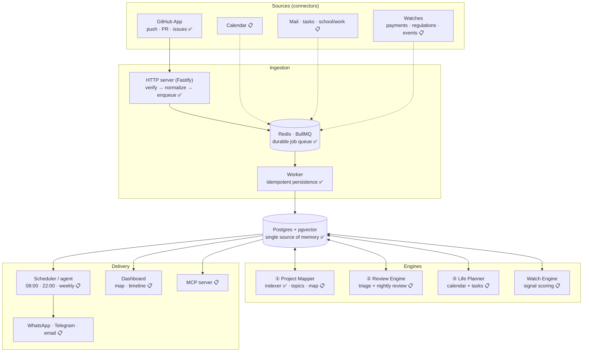
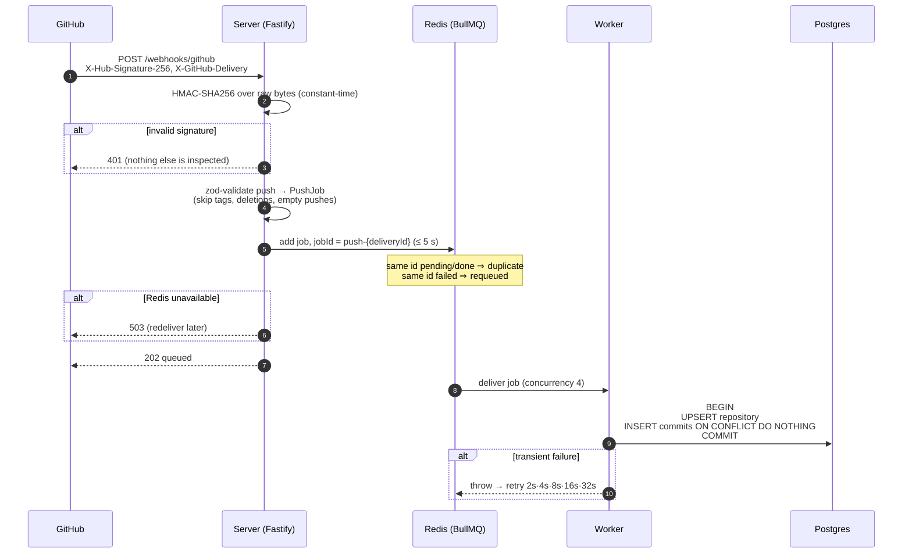
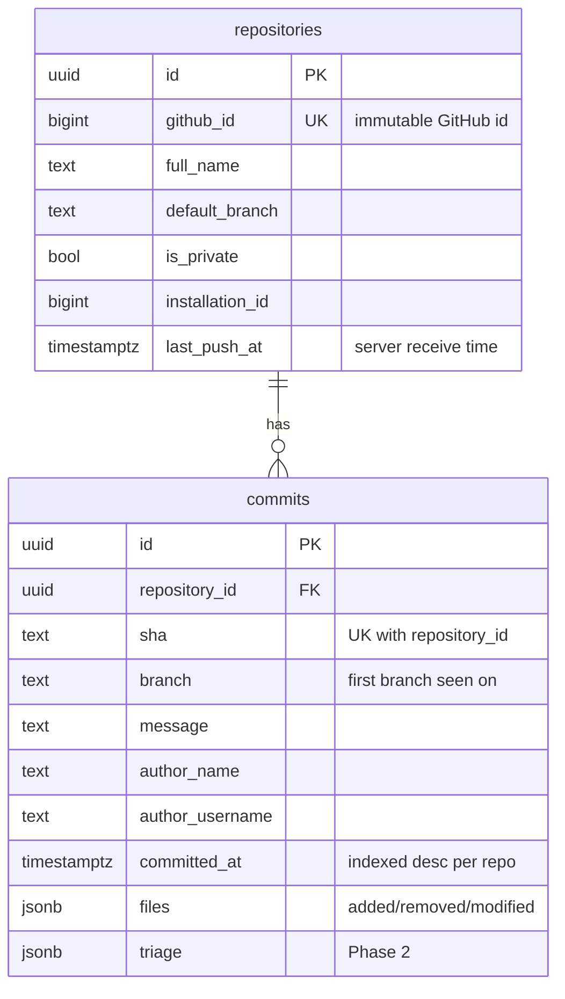
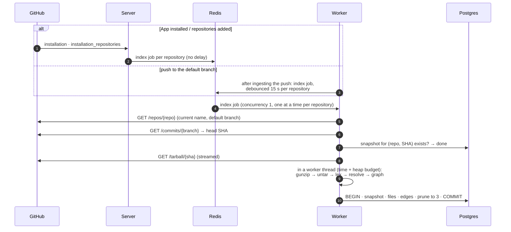
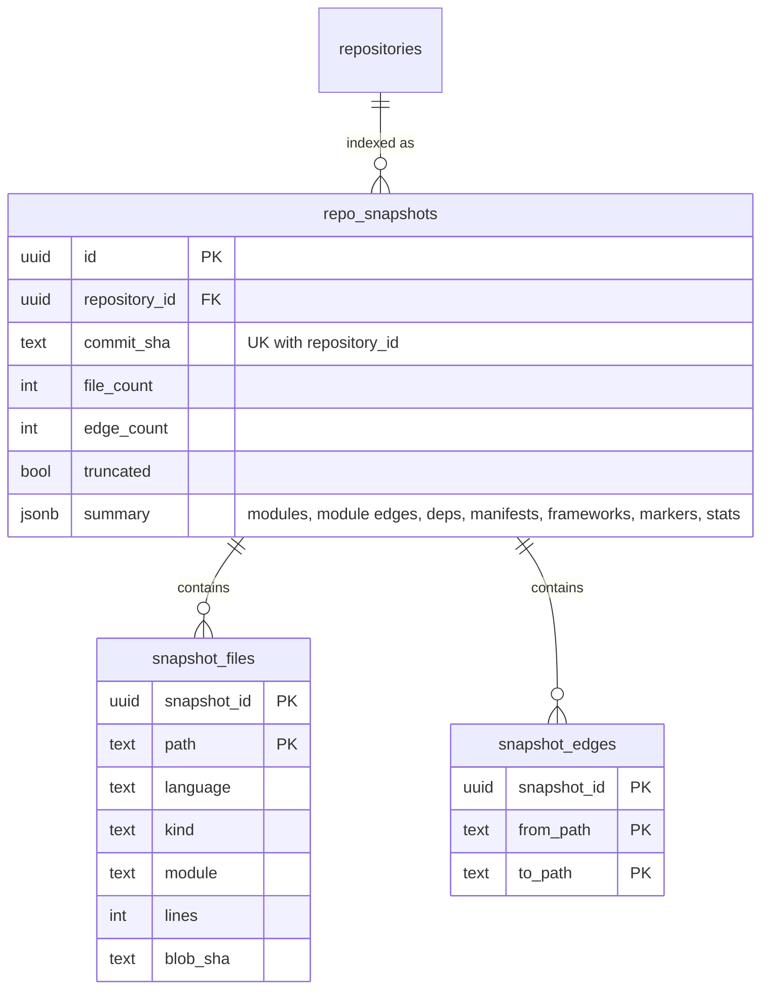

# Waymark architecture

> Status legend: ✅ built · 🚧 in progress · 📋 planned. Phase numbers refer to [ROADMAP.md](ROADMAP.md).

## 1. What the system does

Waymark watches the sources of a person's work and life, turns every event into a **signal**, scores
it, and keeps two artefacts up to date:

- a **living map** of every project: modules, features, progress, and *where you left off*;
- **briefs**: a nightly review of the day's work, a morning plan, a weekly report.

The user never triggers anything. Sources push events in; scheduled agents read the accumulated
memory and write the briefs.

## 2. System overview

### Why this shape

| Decision | Reason |
|---|---|
| **Queue between HTTP and processing** | GitHub waits at most **10 s** for a webhook response and marks slower deliveries failed. The server only verifies, normalizes, and enqueues (milliseconds); slow work (DB, LLM calls later) happens in workers with retries. |
| **One database for everything** | The engines are valuable *because* they see each other's data (a review knows the map; the planner knows the review). Postgres + pgvector keeps relational data and embeddings in one transactional store. |
| **Normalize at the edge** | Raw payloads are validated with zod and reduced to small internal types (`PushJob`). Engines never depend on GitHub's payload shape, and unneeded personal data (author emails) is dropped before it is stored. |
| **TypeScript everywhere, no build step** | One language across server, workers, and dashboard lowers the bar for contributors. Node ≥ 22.18 strips types natively, so packages ship `.ts` sources directly. |

## 3. Phase 0: ingestion pipeline ✅

### Correctness guarantees

| Property | Mechanism | Verified by |
|---|---|---|
| Only GitHub can enqueue work | HMAC-SHA256 over the exact raw body, `timingSafeEqual`, checked before any other parsing | `signature.test.ts`, `app.test.ts` (incl. GitHub's published test vector) |
| Redelivery doesn't double-process | BullMQ job id derived from `X-GitHub-Delivery` | `pipeline.test.ts` |
| Retries and replays don't duplicate data | `UNIQUE (repository_id, sha)` + `ON CONFLICT DO NOTHING`, one transaction per push | `ingest.test.ts` (replay, 5× concurrent delivery) |
| A commit pushed to several branches is stored once | same unique key; first branch wins | `ingest.test.ts` |
| Renames/visibility changes are followed | repository keyed by immutable GitHub id, mutable fields updated on every push | `ingest.test.ts` |
| Out-of-order deliveries don't regress state | `last_push_at` is the server receive time (commit timestamps come from author machines and can be wrong); metadata is only overwritten by newer events | `ingest.test.ts` |
| Redis outage never hangs a webhook | producer connection has no offline queue; enqueue has a 5 s timeout → `503` | `pipeline.test.ts`, chaos run (README) |
| Redelivery recovers permanently failed jobs | a redelivered job id in `failed` state is retried, not treated as duplicate | `pipeline.test.ts` |
| Webhooks that can't be authentic aren't buffered | malformed/missing signature header rejected in `onRequest`, before the body is read | `app.test.ts` |
| Largest possible push is accepted | 25 MB body limit (GitHub's cap); inserts chunked under Postgres' 65,535-parameter limit | `ingest.test.ts` (2,048 commits) |
| Server doesn't fail health checks on a Redis outage silently | `/readyz` uses a fail-fast Redis connection (offline queue disabled) | `app.test.ts` |

### Data model (Phase 0)

## 4. Phase 1a: the indexer ✅

The map starts from structure, not from an LLM: which files exist, what they import, which
packages they depend on. That part is deterministic, cheap, and testable, so it is built first.
Phase 1b names and summarises the modules it finds.

### What an index contains

| Part | How it is computed |
|---|---|
| Files | path, language (60+ by extension/name), kind (source · test · config · docs · asset), size, lines, **git blob SHA** (equals GitHub's tree SHA, so Phase 1b can skip unchanged files) |
| Import graph | own tokenizers for JS/TS (incl. Vue/Svelte/Astro script blocks), Python, and Go that skip comments, strings, templates, and regex literals; then resolvers that follow Node/TypeScript rules (extensions, `.js`→`.ts`/`.d.ts`, `index`, `package.json` `main`/`exports`, `tsconfig` `paths`/`baseUrl` with `extends`), workspace packages, Python package roots and relative imports, and `go.mod` modules |
| Modules | one per workspace package in a monorepo, else the first meaningful directory (`src/auth`); weighted module-to-module edges |
| Dependencies | external packages per ecosystem (npm, PyPI, Go, Cargo), how many files import each, and whether a manifest declares it |
| Frameworks | from runtime dependencies (Next.js, FastAPI, Django, Gin, Axum, …) |
| Markers | `TODO` / `FIXME` / `HACK` / `XXX` / `BUG` found in **comments only** (capped at 1,000) |
| Diagnostics | import counts by outcome (internal, external, builtin, build output, unresolved) and a sample of unresolved imports |

### Why it is built this way

| Decision | Reason |
|---|---|
| **Tarball, streamed** | One HTTP request per snapshot instead of one API call per file, no git binary, no disk writes, and memory proportional to the file count, not the repository size. |
| **Own tokenizers instead of tree-sitter (for now)** | Imports are the only syntax the map needs. A tokenizer that understands comments, strings, templates, and regex literals finds them exactly and is pure TypeScript (no native or WASM build). Tree-sitter remains an option for richer symbols later. |
| **Index the head at run time, not the pushed SHA** | Push jobs can be processed out of order. Resolving the default branch head when the job runs guarantees the newest commit is indexed last. |
| **Per-repository debounce** | Pushes come in bursts (a rebase, several quick commits). One BullMQ deduplication key per repository: a push while the job waits replaces it and restarts the 15 s delay; a push while it runs is kept and starts right after (`keepLastIfActive`). At most one waiting and one running job per repository, so no push is lost and runs never overlap. |
| **Indexing in a separate thread** | Repository content is untrusted and indexing is CPU-bound. In-process, one pathological file would block the event loop: no timeout could interrupt it and the queue lock could not be renewed, so the job would be re-run again and again. The tarball stream is transferred to a worker thread with a hard time budget (10 min) and heap budget (1.5 GB); exceeding either kills the thread and fails the job once. |
| **Snapshots keyed by (repository, commit)** | Retries, redeliveries, and concurrent workers converge on one row. The newest three are kept so changes between snapshots can be compared. |
| **The repository is data, never code** | Nothing from the repository is executed or `require`d; symlinks, hard links, devices, and entries outside the archive's root folder are skipped; paths are normalised (no `..`, no absolute paths, ≤ 1,200 UTF-8 bytes); every size, depth, and count read from it is capped. |

### Guarantees

| Property | Mechanism | Verified by |
|---|---|---|
| No false edges from comments, strings, or regexes | tokenizers skip them; unterminated strings recover at the line break | `lexers.test.ts` |
| Resolution follows the toolchains' rules | Node/TS lookup order, `exports` conditions, `tsconfig` `paths` + `extends`, Python roots, `go.mod` | `resolve.test.ts`, self-index of this repository (100 % resolved) |
| Same input, same index | stable ordering everywhere, independent of archive order | `indexer.test.ts` |
| Hostile archives can't escape or exhaust | regular files under the archive's root folder only; path normalisation (≤ 1,200 UTF-8 bytes); per-file, total, and decompressed-byte caps that truncate instead of failing; stream destroyed on early exit | `sources.test.ts` |
| Large repositories degrade, not fail | file-count and byte limits mark the snapshot `truncated` | `indexer.test.ts` |
| A burst of pushes indexes once; a push during indexing is not lost | deduplication: replace while delayed, keep the newest while active | `indexing.test.ts` (real Redis) |
| A pathological repository can't stall the worker | linear-time lexers, resolvers, and parsers (timed tests on adversarial input); indexing thread with hard time and heap budgets | `regressions.test.ts`, `isolated.test.ts` |
| Text Postgres rejects never blocks a repository | NUL and unpaired surrogates are removed before writing; marker text is cut at code points | `indexing.test.ts` |
| Concurrent or repeated indexing stores one snapshot | `UNIQUE (repository_id, commit_sha)` + `ON CONFLICT DO NOTHING`, existence check before download | `indexing.test.ts` |
| Gone or empty repositories don't retry forever | 404/410/451 → unrecoverable; 409 (empty) → skipped | `indexing.test.ts` |
| Repository names can't rewrite API URLs | `owner/name` validated, `.`/`..` segments refused | `app.test.ts`, `installation.test.ts` |

### Data model (Phase 1a additions)

## 5. Engines (planned)

### ① Project Mapper: from index to living map (Phases 1b–1d)
- **Topic grouping (1b):** an LLM names and summarises the modules from the index ("Auth",
  "Payments", "Editor UI"), splitting or merging them where the directory layout misleads.
- **Incremental update:** each new snapshot is compared with the previous one by blob SHA; only
  topics with changed files are re-summarised. The repository is never re-read wholesale.
- **"Where you left off" (1d):** recently touched topics, open branches, unfinished PRs, new
  TODO/FIXME, WIP commits, and the next roadmap milestone.

### ② Review Engine (Phase 2)
- **Triage on every push** (small, fast model): risk level, category, "untested change". Stored,
  not notified.
- **Nightly deep review** (batch API): the day's diffs + map context + the user's pattern memory →
  risky changes, recurring mistakes, three suggestions for tomorrow.
- **Pattern memory:** findings are keyed and counted ("missing null check ×4"), feeding the weekly
  progress report.

### ③ Life Planner and Watch Engine (Phases 3–5)
- Calendar events, school/work tasks, and project milestones are normalized into one task model.
- A **watch** is a natural-language instruction turned into a scheduled check ("rent is due on the
  5th", "regulations affecting my company", "jazz events near me"). Each produces signals that are
  scored for importance; only the top items reach the morning brief.
- Hard limits: watches **observe and remind**. They never move money, and regulatory alerts always
  link to the official source and are not legal advice.

## 6. Security and privacy model

- GitHub App with minimum permissions: `metadata:read`, `contents:read` (plus `pull_requests:write`
  only if the user enables fix-PR suggestions).
- Webhook secret ≥ 16 chars, enforced at startup.
- Store structure and summaries, not source code: snapshots hold paths, languages, line counts,
  hashes, imports, and comment markers, never file contents. Drop data the product doesn't use.
- Self-hostable end to end; local-model support is planned for users who keep everything on their
  own machine.
- The agent asks before it sends anything on the user's behalf.
